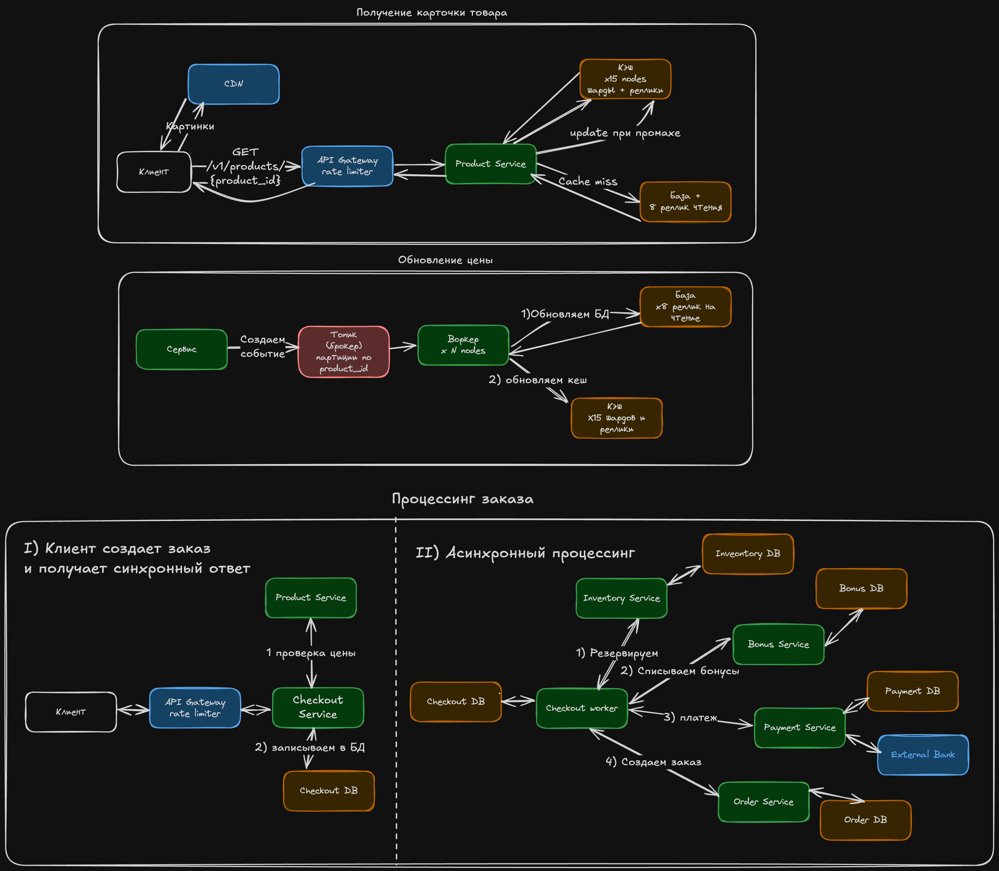

# ДЗ 3. Чёрная пятница в Ozon: пик ×20 и живые цены

Условие лежит на странице домашки на платформе. Тут только твоё решение.
Идёшь по порядку: каждый шаг опирается на предыдущий.

## Уточняющие вопросы

Запиши свои до того, как откроешь карточку ответов интервьюера.

- Сколько у нас товаров
- Сколько у нас юзеров
- Сколько в среднем заказов в день
- Проектируем ли мы хранение оформленных заказов или останавливаемся на этапе создания
- Проектируем ли мы индивидуальные рекомендации ленты?
- Есть ли географическое распределение

- Какой средний размер карточки?
- Допустима ли задержка обновления ленты? Добавление/удаление товаров, изменение цены
- Как часто обновляется товар в среднем, сколько карточек обновляется в сутки, сколько создается, какие пики
- Есть ли бизнес ограничения на покупку для защиты от ботов и перекупов

- Что происходит, если бонусов/средств у клиаента не достаточно? Сразу ли откатываем предыдущие операции?
- Что если недоступен сервис заказов - сколько мы ждем, что показываем клиенту или сразу отменяем заказ? Позволяем ли сразу создать новый
- Какая пиковая частота показа карточки? Равномерно ли распределены показы между карточками?
- Какую нагрузку выдерживают узел базы и узел кеша
- Что показываем если узел базы или кеша не доступен? Можем ли показать устаревшее щначение?
- Сколько мы можем ждать на разных этапах оформления заказа? Сколько ждет резерв, бонусы, списание банка. Общий ttl или также дополнительный на каждом этапе? Что отображаем клиенту? Возвращаем статус в процессе или синхронно ждем завершения всех операций создания заказа?

### Ответы

-   Чтения вечерний пик 50 тыс/с, в Чёрную пятницу множитель ×20 к нему
-   100 млн активных карточек, одна занимает около 2 КБ
-   1% каталога собирает 90% просмотров, а верхняя десятка товаров распродажи одна берёт 20%
-   Предел узла кеша - 100 тыс запросов в секунду и 64 ГБ памяти на узел
-   Предел узла базы - 10 тыс чтений в секунду на реплику, поднять можно до восьми реплик
-   В обычный день 3 млн изменений в сутки. В полночь распродажи одна пачка на 400 тыс товаров
-   устаревшая цена до 60 секунд. Дольше уже авария: человек видит ценник, которого больше нет
-   Оформлений в обычный вечерний пик 100 в секунду, в Чёрную пятницу тот же множитель ×20
-   Резерв и бонусы возвращаются своей операцией. Оплата откатывается возвратом, деньги идут человеку до трёх суток
-   Резерв на складе живет 15 минут: если оплата не дошла, товар возвращается в продажу сам
-   Внешний банк в среднем отвечает за 300 мс, p99 3 с. Раз в несколько часов уходит в отказ на две-пять минут
-   оформлений около 3%: человек жмёт кнопку второй раз, когда ответ задерживается
-   Не больше 5 единиц одного дефицитного товара в одни руки
-   Авария показать цену старше минуты, продать дороже показанного, не дать оформить заказ
-   Допустимая деградация - рекомендации, отзывы, точный остаток, персональную сортировку. Оформление заказа выключаем последним

## Требования

Что система делает:

- Показывает карточки товаров со стоимостью и описанием, цена должна быть не старее 1 минуты
- Позволяет оформить заказ, во время заказа резервирует товар, списывает бонусы, средства с карты, заводит заказ. Эти процессы лежат на разных сервисах.
- При ошибки на одном из этапов предыдущие откатываются, бонусы и резервация своими операциями, деньги - обратной транзакцией
- Позволяет изменять описание карточки - ее стоимость и описание, про показ товаров без наличия не сказанов в условиях, поэтому допустим тут событийную консистентность
- Нельзя продать пользователю товар дороже - запрашиваем подтверждения пользователя
- 3% повторных заказов, нужно избежать дублирования, а также дублей на транзакциях

Какой она должна быть по масштабу, скорости, надёжности:

- Чтений 50 тыс rps в пике вечером, распродажа х20
- Оформлений 100rps в пике вечером, распродажа x20
- Активных карточек 100 млн, 2 KB вес одной
- 1% карточек держит 90 процентов просмотра, верхние 10 товаров 20%
- 3 млн изменений в сутки, в распродажу - пачка из 400 тыс изменений
- резерв держится 15 минут
- Цена в ленте не старше 60 секунд, нельзя продать дороже фактической цены
- Функционал оформления заказа самый важный по доступности

## Прикидка

- Чтений 50 тыс rpc в пике, распродажа - 1млн rps
- оформлений 100 rps в пике, распродажа - 2тыс rps
- хранение карточек - 200 млн KB = 200 тыс MB = 200 GB, шард постгреса держит до 500, для хранения шардирование не нужно
- Предел узла кеша 100тыc rps
- обычная запись 3млн в сутки = 34,7 rps, обычный пик возьмем в x5 = 175rps

- 1% карточек собирает 90% просмотров = 1 млн карточек занимает 45тыс rps, распродажа - 900 тыс rps, размер под горячие карточки = 1 млн * 2 KB = 2GB
- первые 10 карточек занимают 20% трафика = 10тыс rps, 200 тыс в распродажу
База вывозит до 80 тыс rps с 8 репликами, итого на распродаже 920 тыс должно попадать в кеш, цель 94,4% cache hit
- узлов кеша = 1 млн / 70тыс = 15 узлов

## Модель данных

### Координатор

Checkout

| id | user_id | status | order_id |
| --- | --- | --- | --- |

CheckoutItem

| id | checkout_id | product_id | confirmed_unit_price | quantity |
| --- | --- | --- | --- | --- |

### БД каталога

Product

| id | title | description | price | price_updated_at | available_quantity | quantity_updated_at |
| --- | --- | --- | --- | --- | --- | --- |

### БД корзины

Cart

| id | user_id |
| --- | --- |

CartItem

| id | cart_id | product_id | quantity |
| --- | --- | --- | --- |

### БД склада

Inventory

| id | product_id | available_quantity |
| --- | --- | --- |

Reservation

| id | checkout_id | product_id | quantity | status | created_at | updated_at | expires_at |
| --- | --- | --- | --- | --- | --- | --- | --- |

Reservation_outbox

| id | reservation_id | event_type | payload | status |
| --- | --- | --- | --- | --- |

### БД бонусов

Balance

| id | user_id | amount |
| --- | --- | --- |

Operation

| id | balance_id | amount | checkout_id | status | type |
| --- | --- | --- | --- | --- | --- |

### Сервис платежки

Payment

| id | user_id | checkout_id | amount | status | external_payment_id | payment_method_token |
| --- | --- | --- | --- | --- | --- | --- |

### Заказы

Order

| id | user_id | total_amount | checkout_id |
| --- | --- | --- | --- |

OrderItem

| id | order_id | product_id | quantity | unit_price |
| --- | --- | --- | --- | --- |

## API

GET /v1/products/{product_id}
    out: {data: Product}

GET /v1/cart
    out: {data: []ProductItem}

PATCH /v1/cart
    in: {type: ADD | REMOVE | DEC, product_id: string, new_amount?: int (если не delete) }

POST /v1/checkouts
    Idempotency-Key: <checkout_id>
    in: {
        cart_id: string,
        items: []{product_id: string, quantity: int, confirmed_unit_price: int}
        bonuses_to_spend: int
        payment_method_token: string
    }

    out: 
     202 - Accepted {checkout_id: string, status: string}
     409 Conflict - объект недоступен или цена изменилась {message: string, data: {Conflicts: []{product_id, old_price, new_price}, Expired: []product_id}} 

POST /v1/checkouts/{checkout_id}/price-confirmation
in: {
    items: []{product_id: string, confirmed_unit_price: int}
}
out: ответы из v1/checkouts на создание заказа
## Схема

Как запрос идёт по схеме:
### Получение карточки товара
1) Клиент делает запрос в Api Gateway
2) API Gateway выполняет роль балансировщика и rate-limiter, если лимит не превышен - отправляет на актуальную ноду product service
3) Product Service ищет товар в соответствующем шарде в кеше
4) если ответ есть - отдает из кеша, если нет - идет в бд, получает данные
5) записывает в кеш, отдает клиенту
6) клиент получает информацию о продукте, по ссылкам из описания получает картинки из CDN

### Обновление цены
1) Сервис создает событие в топике на обновление цены. Сообщение попадает в партицию по product_id
2) Воркер берет пачку событий, сверяет версии цены, если запись старее чем в бд - останавливает обработку. Если версия свежая - обновляет бд и идет дальше, если одинаковая - не перезаписываем и идем обновлять кеш
3) Воркер обновляет запись в кеше

### Процессинг заказа
1) Клиент отправляет запрос на создание заказа
2) API Gateway выполняет роль балансировщика и rate-limiter, если лимит не превышен - отправляет на актуальную ноду Checkout сервиса
3) Checkout сервис делает запрос в product Service для сверки цены, если цена в заказе меньше цены товара - создаем чекаут со статусом PRICE_CONFIRMATION_REQUIRED и возвращаем уведомление клиенту для подтверждения, если товар подешевел берем новую цену из продукт сервиса, если все сходится - цену оставляем 
4) Создаем запись в БД Checkout сервиса со статусом New, возвращаем клиенту ответ - ок с id checkout

Асинхронная обработка
5) Воркер читает записи со статусом New, отправляет в инвентори сервис для резервирования заказа, ждет ответа от сервиса
6) после успешного резервирования воркер отпрвляет заказ в сервис бонусов для списания и ждет ответа
7) После списания бонусов воркер отправляет запрос в payment сервис и ждет выполнения оплаты
8) После подтверждения оплаты сервисом воркер отправляет запрос в Order Сервис для создания заказа

все операции для идемпотентности содержат checkout_id и в случае ретраев проверяют наличие уже созданной операции. В случае отказов делаем откаты
1) нет товара - возвращаем failed 
2) Не удалось списать бонусы - освободить резерв
3) Банк подтвердил отказ - вернуть бонусы, освободить резерв
4) Результат банка неизвестен - ждать/проверять ту же платёжную операцию
5) Не удалось создать заказ - повторять идемпотентный вызов
6) Создание заказа окончательно невозможно - возврат платежа, бонусов и резерва

## Углубление

Предлагаю углубиться сперва в явно подсвеченную проблему в задаче - обновление 400 тысяч цен на товары при обнулении кеша. Для решения этой проблемы нужно не очищать кеш, а обновлять при записи новой цены. Для того чтобы ретраи не убивали базу запросами одного товара когда его нет в кеше - используем на нодах сервера singleflight паттерн. Для того чтобы отставшим сообщением не засетить в кеш старую цену нужно использовать версионирование или временную метку обновления.

База может не вывести 400 тысяч записей если они придут одновременно, поэтому воркер берет обновления фиксированными батчами. Требуется обновление цены не больше 1 минуты, нам достаточно 400k/60 = 6.7k rps на запись, распределенные между несколькими воркерами

Для защиты от ботов используем rate limiter, конкретные цифры ограничений может назвать бизнес или можем определить по метрикам, до метрик можем взять например 60 rpm с одной учетки и 180 rpm с одного ip, если будет не хватать обычным юзерам - увеличиваем порог, если наплыв ботов не уменьшается - ужесточаем условия.   
Защиту от скупщиков реализовываем на уровне сервиса, создать в checkout сервисе таблицу для посчета лимита пользователя по дефицитному товару и не позволять купить свыше установленного предела. Для защиты от гонки при нескольких покупках - делать бронирование квоты при заказе.

Для горячих карточек, собирающих 90% запросов требуется 2Gb памяти по подсчетам и 45k rps, что с запасом умещается в шард кеша, однако в черную пятницу нагрузка повышается в 20 раз и rps подскакивает до 900k rps и один шард не справится. По подсчетам нам для обслуживания 1млн rps потребуется 15 нод кеша, поэтому горячие ключи распределятся между шардами. Для подстраховки можем использовать чтение с реплик для горячих шардов или сделать копии горячих ключей на нескольких шардах, это выполняется динамически, считать rps на ключе можно или через прокси кеша или отдельным сервисом, который будет парсить request log.

Для того чтобы не допускать ошибочных повторных заказов используем checkout_id, генерируемый на клиенте для каждого уникального оформления заказа. Для предотвращения дублей между операциями транзакции - используем этот же ключ идемпотентности транзакции